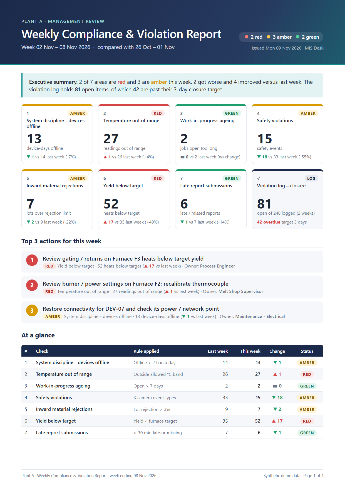

# Weekly Compliance & Violation Report

**Turns a week of raw plant data into a one-click, management-ready compliance PDF and a violation log that tracks every issue until it is closed.**



[Full sample PDF (4 pages)](output/sample_weekly_compliance_report.pdf) · [Sample violation log (Excel)](output/violation_log.xlsx)

> Based on compliance reporting I automated for manufacturing clients in my current role. This version uses **synthetic data** for a fictional "Plant A".

---

## Problem → What I built → Result

**Problem.** Every week, someone had to pull data from several systems (device status, temperature logs, work-in-progress, safety cameras, inward inspection, yield, report submissions), compare it with the rules by hand, build tables in Excel and write a summary for management. It took hours, the rules lived in people's heads, and issues found one week were often forgotten the next.

**What I built.** A small Python tool that:

1. **Reads** a week of operational data (plus the previous week for comparison).
2. **Checks** it against limits kept in a plain settings file ([`config/thresholds.yaml`](config/thresholds.yaml)), so plant or MIS staff can change a limit without touching code.
3. **Produces a 4-page PDF** with:
   - an **executive summary** page: 7 KPI cards, red / amber / green status, week-over-week arrows and the **top 3 actions for this week** with owners;
   - one section per check: the count, the change versus last week, a daily chart and a short table of the worst items.
4. **Maintains a violation log** in Excel (`ID, date, category, detail, owner, status, closed_on`) with closure targets, overdue flags, a drop-down for Open / Closed, and a summary sheet that updates itself when an item is closed.

**Result.**

- Weekly collation goes from **hours of manual work to a few minutes** (one command).
- **Thresholds are editable without code**: change a number in the settings file and re-run.
- Every discrepancy gets an **ID, an owner and a closure date**, so resolution is tracked and late closures are visible (on-time closure % per category).
- Management gets the same clean, consistent report every week, with the 3 things that need attention first.

## The 7 checks

| # | Check | Example rule (editable) |
|---|-------|-------------------------|
| 1 | System discipline – devices offline | Device offline more than 2 hours in a day |
| 2 | Temperature out of range | Hourly reading outside the allowed band per furnace |
| 3 | Work-in-progress ageing | Job still open more than 7 days after start |
| 4 | Safety violations | Missing helmet / safety shoes / restricted-zone camera events, by area |
| 5 | Inward material rejections | Supplier lot with more than 3% rejected |
| 6 | Yield below target | Heat yield below the furnace target |
| 7 | Late report submissions | Daily report more than 30 min late, or missing |

Each section turns **green / amber / red** based on limits in the same settings file.

## Skills shown

- **MIS reporting & automation**: recurring weekly report built end to end, from raw data to a management-ready PDF.
- **Data analysis with Python (pandas)**: cleaning, joining, rule checks, week-over-week comparison, ranking the top offenders.
- **Data quality & discrepancy tracking**: a violation log with owners, closure targets, overdue flags and on-time closure %.
- **Excel (openpyxl)**: formatted log with filters, frozen headers, drop-down validation, conditional formatting and live COUNTIFS summary.
- **Report design**: HTML/CSS templating (Jinja2) exported to PDF; KPI cards, RAG status, clear executive summary.
- **Configurable business rules**: thresholds in a plain YAML file that non-technical users can maintain.
- **Reproducibility**: synthetic data generator with a fixed seed.

## Project structure

```
config/thresholds.yaml      limits, owners and action wording (edit this, no code needed)
generate_sample_data.py     creates two weeks of synthetic data (fixed seed)
sample_data/*.csv           the synthetic input data
build_report.py             checks + PDF + Excel log
templates/                  report layout (HTML + CSS)
output/                     sample PDF and violation log
docs/report_preview.png     picture of page 1
```

## How to run

Requires Python 3.10+ and Google Chrome (used in headless mode to print the PDF).

```bash
pip install -r requirements.txt
python generate_sample_data.py     # optional: re-create the sample data
python build_report.py             # writes the PDF, Excel log and preview image
python build_report.py --no-pdf    # HTML + Excel only (no Chrome needed)
```

To change a rule, edit `config/thresholds.yaml` (for example `max_age_days: 7`) and run `python build_report.py` again.

---

*All names, areas, suppliers and figures are fictional and generated for this demo.*
